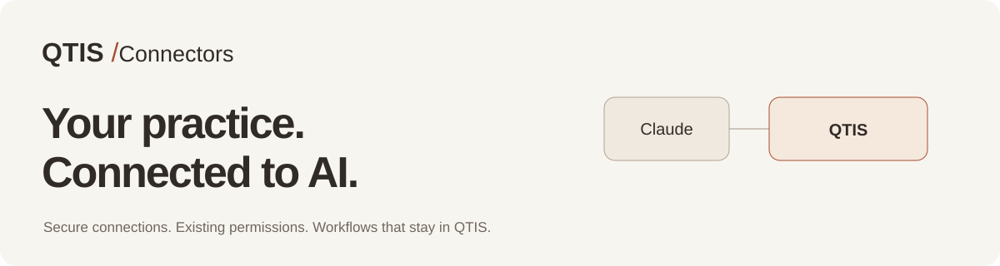

<p align="left"></p>

# QTIS AI MCPs

Connect your practice to the AI tools you already use. Discover QTIS connectors, explore their capabilities, and connect using your existing staff permissions.

**[Explore the connector directory](https://platform.qtis.ai/connectors)** · **[Connect Patients & Clients](https://platform.qtis.ai/connectors/patients)** · **[Claude setup](docs/claude.md)**

## Connect Patients & Clients

Add this remote MCP server in Claude:

```text
https://platform.qtis.ai/mcp/patients
```

Choose **Sign in now** and **Register automatically**, then sign in with your own QTIS staff account. Choose read-only or manage access, allow the connection, and enable it in your chat. No shared password, manual client secret, API key, or local server installation is needed. [Full instructions →](docs/claude.md)

Start with:

> Use the QTIS Patients & Clients connector to list the practices I can access. Do not create or change any records.

## Connector directory

| Connector | Category | Availability |
| --- | --- | --- |
| [Patients & Clients](connectors/patients/README.md) | Patient care | Available |
| [Calendar](connectors/calendar/README.md) | Operations | Limited access |
| [Clinical Notes](connectors/clinical-notes/README.md) | Patient care | Planned |
| [Forms & Consents](connectors/forms/README.md) | Patient care | Planned |
| [Inventory](connectors/inventory/README.md) | Operations | Planned |
| [Messaging](connectors/messaging/README.md) | Growth | Planned |
| [Billing](connectors/billing/README.md) | Finance | Planned |
| [Practice Analytics](connectors/analytics/README.md) | Growth | Planned |
| [Team & Locations](connectors/team/README.md) | Operations | Planned |

**Available** connectors publish a working connection URL. **Limited access** requires client registration or activation; follow the connector's guide. **Planned** entries describe intended scope and do not expose an MCP server. No release date is promised.

## Patients & Clients

Search and read profiles, create records, update contact details, and archive profiles with explicit approval. Five read tools and three manage tools work inside the practice you select. QTIS checks current account state, practice access, and role for each operation.

- [Tool contracts](connectors/patients/tools.json) and [tool reference](docs/tools.md)
- [Profile states and archival](docs/patient-states.md)
- [OAuth and permissions](docs/authentication.md)
- [Read-only prompts](examples/read-only-prompts.md) and [approved changes](examples/approved-changes.md)
- [Troubleshooting](docs/troubleshooting.md)

Archive preserves history and disconnects linked patient app access. Archived profiles are read-only and hidden by default. The connector does not expose clinical notes, images, documents, birth dates, or billing records.

## What's in this repository

This repository contains the public connector registry, setup guides, published tool schemas, prompts, a dependency-free JavaScript reference client, and public endpoint checks. The hosted service runs in QTIS; cloning this repository does not create a separate patient database or grant access to a practice.

```sh
git clone https://github.com/AgentiveX/QTIS-AI-MCPs.git
cd QTIS-AI-MCPs
npm run check
npm test
npm run smoke
```

Node.js 22 or later. No package installation is required. Checks use public metadata; they do not log in, read patient records, or make changes. The optional [reference client](clients/reference-client.mjs) supports applications that already implement QTIS OAuth.

## Support

Use [QTIS connector support](https://platform.qtis.ai/connectors/patients/support) or contact [krish@agentivex.ai](mailto:krish@agentivex.ai). Never put patient information, passwords, or connection tokens in GitHub issues. See [SECURITY.md](SECURITY.md) for private security reports.

[Privacy](https://platform.qtis.ai/connectors/patients/privacy) · [Terms](https://platform.qtis.ai/connectors/patients/terms) · [License](LICENSE)
